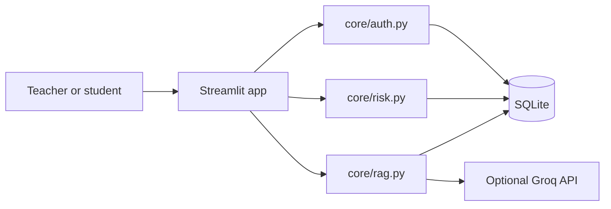

# KavachED architecture

KavachED is a Streamlit application with a small Python service layer and SQLite persistence.

## Data isolation

Each teacher owns a workspace. Application queries include that workspace ID; student reads additionally require the student's linked roll number. SQLite statements use parameters. Passwords use PBKDF2-HMAC-SHA256 with a fresh 16-byte salt.

## Question answering

Uploaded text is split into overlapping passages, retrieved using TF-IDF cosine similarity, and passed to the optional Groq service with an instruction to stay grounded in supplied context. Low similarity returns an explicit no-match response.

## Risk calculation

The risk score is a transparent sum of attendance, missing assignments, assessment, pending-project, and recent-note signals. It is not a predictive machine-learning model.
